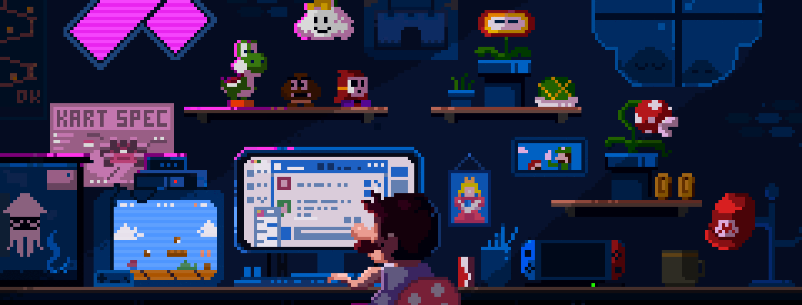
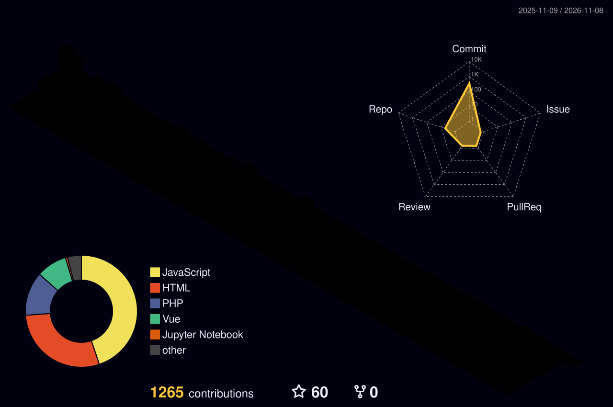

  <i>"If I have something to do today, I will do it now. To do something else tomorrow."</i>

<h3 align="center">
  
</h3>

  I'm an IT graduate and an <strong>IT Systems Developer at Central Luzon State University</strong>, working across the full stack. 
  I build academic systems and personal projects, from everyday web tools to browser games, using Laravel, Vue, and Tailwind.

---

### Connect with Me

  
  
  
  
  
  
  
  

 

---

## Projects

My current work at **CLSU** focuses on **CSMS**, a course syllabus management system for creating and managing academic syllabi.

Outside work, I build tools and projects around practical needs and personal interests:

- **DFD Studio (Flowdesk)** — A browser-based editor for creating and exporting data flow diagrams.
- **Office Task Tracker** — A tool for organizing and tracking office tasks.
- **TRGC** — A church attendance system and website for The Risen Generation Church.
- **StyleGen & ToolGrid** — Visual CSS generators and browser-based utilities.
- **GameZone** — A collection of interactive browser games.

---

## Tech Stack & Resources

| Category | Technologies & Resources |
| --- | --- |
| Languages |      |
| Frontend |        |
| Backend & Database |     |
| Tools & Design |       |
| Editors & AI Tools |    |
| Learning Platforms |     |
| Documentation |   |

### Gaming (Just for Fun)

  

---

## GitHub Stats

  
  

---

## Contribution Snake

<picture>
  <source media="(prefers-color-scheme: dark)" srcset="https://raw.githubusercontent.com/Je-ric/Je-ric/output/github-snake-dark.svg" />
  <source media="(prefers-color-scheme: light)" srcset="https://raw.githubusercontent.com/Je-ric/Je-ric/output/github-snake.svg" />
  
</picture>

## Pacman Contributions

<picture>
  <source media="(prefers-color-scheme: dark)" srcset="https://raw.githubusercontent.com/Je-ric/Je-ric/pacman-output/pacman-contribution-graph-dark.svg" />
  <source media="(prefers-color-scheme: light)" srcset="https://raw.githubusercontent.com/Je-ric/Je-ric/pacman-output/pacman-contribution-graph.svg" />
  
</picture>

